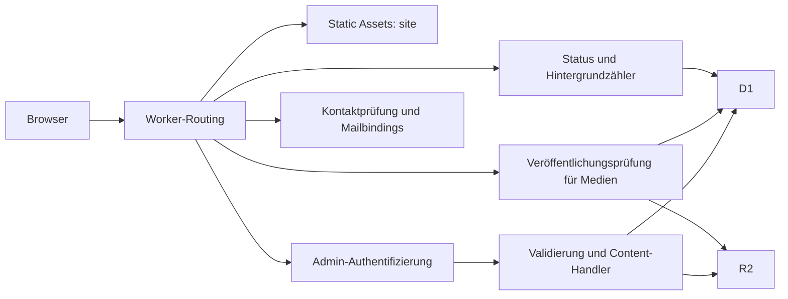

# Architektur

Stand: **18. Oktober 2026**, lokaler Quellcode. Dieses Dokument beschreibt implementierte Verträge; offene Abweichungen stehen im [Audit](docs/repository-audit.md). Einstieg: [README](README.md), Prüfungen: [docs/testing.md](docs/testing.md).

## Laufzeit und Routing

`site/` ist der Document Root von Workers Static Assets. HTML/CSS/Vanilla JavaScript werden ohne Frontend-Build ausgeliefert. Der Worker empfängt die in `assets.run_worker_first` genannten Pfade, führt API-, Authentifizierungs-, Medien- und Dokumentlogik aus und delegiert übrige Requests an `env.ASSETS.fetch`.

Die Konfiguration umfasst `/api/*`, `/admin/*`, `/media/v1/*`, `/`, `/index.html`, `/page/*`, Status-Aliase und SEO-Dateien. Produktion ergänzt gesperrte interne Asset-Pfade. [Cloudflare dokumentiert die Worker-first-Reihenfolge](https://developers.cloudflare.com/workers/static-assets/routing/worker-script/).

Es gibt keine Queue, keinen Durable Object, keinen Cronjob und kein serverseitiges Rendering der Redaktionsoberfläche. Die Dokument-Metadaten werden im Worker bei geeigneten HTML-Antworten umgeschrieben.

## Worker-Module

| Datei unter `worker/src/` | Verantwortung |
| --- | --- |
| `index.js` | Routing, CRUD-Handler, Uploads/Promotion, Gallery-Ordner, Formulare und SEO |
| `access.js` | Lokaler Token, RS256-JWT, JWKS-Cache und E-Mail-Allowlist |
| `admin-methods.js` | Methodenvertrag und Route-Präzedenz für Content-Admin-APIs |
| `hosts.js` | Vier Site-Domains und ihre vier `www`-Aliase |
| `security-headers.js` | Gemeinsame Report-Only-CSP |
| `remote-media.js` | Begrenzte Google-Drive-Bilddownloads mit geprüften Weiterleitungen |
| `media.js` | Medienpfade, Veröffentlichungsprüfung, Vorschau, ETag und Range |
| `news.js` | News-Validierung, SQL und öffentliche/admin Datenformen |
| `content.js` | World Points und Partners |
| `projects.js` | Projektzeiträume, Phasen und Übersetzungen |
| `videos.js` | Videos, Collections, YouTube-Normalisierung und WebVTT |
| `interviews.js` | Interview-Materialien und Übersetzungen |
| `online-project-media.js` | Video-/PDF-Datensätze und Dateien in R2 |
| `status.js` | Live-Probes, Aufrufaggregate, Details und Bot-/DNT-/GPC-Gruppen |
| `contact-receipt.js` | Reine Mailvorlagen und isolierter Bestätigungsversand |

Alle 15 Laufzeitmodule haben eine gleichnamige `.test.js`-Datei. Weitere Tests prüfen querliegende Verträge. Der SQLite-Helfer liegt außerhalb von `src/` unter `worker/test/helpers/database.js`.

## Frontend-Module

| Pfad | Aufgabe |
| --- | --- |
| `site/index.html` | Landingpage-Struktur, Programme, Ausgangsinhalte und beide Formulare |
| `site/source/style/style.css` | Gemeinsame Gestaltung, Themes und responsive Regeln |
| `site/source/style/subpage.css` | Wiederverwendeter Unterseiten-Header und gemeinsame Dokumentregeln |
| `site/source/scripts/language.js` | Wörterbuch `T`, `currentLang`, `setLang`, Text-/Attributübersetzung |
| `site/source/scripts/news-data.js` | Gebündelte News für Landingpage, News-Seite und Seed |
| `site/source/scripts/main.js` | Navigation, Theme, Hero, News-Dialoge, Projects, Partners und Lazy Loading |
| `site/source/scripts/contact-mail.js` | Formularvalidierung im Browser, Turnstile und Kontakt-Requests |
| `site/source/scripts/mirokit-world-map.js` | Lazy geladenes Canvas-Kartenmodul, API-/Fallback-Punkte und Länderfeed |
| `site/source/scripts/online-project-topics.js` | Zehn Topic-IDs, gemeinsam für Worker/Admin/Online Projects |
| `site/source/scripts/subpage.js` | Eigenständige Theme-Steuerung für Kontakt-/Datenschutzseiten |
| `site/page/gallery/` | Ordner-, Foto- und Videoansicht, Suche, Dialog und eigener HTML5-Player |
| `site/page/news/` | Eigenständige News-Liste, Filter, Suche, Sortierung und Dialog |
| `site/page/interviews/` | Gesprächsvideos und Material-Tabs |
| `site/page/onlineProjects/` | Themenfilter, Masonry-Fotos, eigener Videoplayer und PDF-Karten |
| `site/page/contactPersons/` | Profil-/Impressumsfenster und Hash-/Tastatur-Tabs |
| `site/page/privacyPolicy/` | Russische Richtlinie, EU-Platzhalter und regionale Dokument-Tabs |
| `site/status/` | Öffentliche Dienst- und Aufrufansicht, zusätzliches Statuswörterbuch |
| `site/admin/admin.js` | Klassen für Config, Services, Notice, einzelne Inhaltsbereiche, Shell und App |
| `site/admin/media-preview.js` | Geschützte Medien-URLs und lokale Token-/Blob-Vorschau |
| `site/admin/online-project-media.js` | Video-/PDF-Editor und lokale PDF.js-Vorschau |
| `site/admin/status/` | Geschützte Aufrufdetails und Diagnosegruppen |

Landingpage-Skripte laden Sprache, News-Ausgangsdaten und Hauptinteraktionen; Formulare und Karteninitialisierung werden separat koordiniert. Unterseiten laden eigene Skripte und sollen nicht unbeabsichtigt den Landingpage-Bootstrap starten.

## Öffentliche APIs

| Methode / Pfad | Antwortbestand |
| --- | --- |
| `GET/HEAD /api/v1/news` | `news`, nur `published` und UTC-Datum erreicht |
| `GET/HEAD /api/v1/gallery?collection=gallery` | `gallery`, `folders`, `quotes`; Collection optional, `online-projects` ebenfalls erlaubt |
| `GET/HEAD /api/v1/videos` | `videos`, Collection `general` |
| `GET/HEAD /api/v1/interviews` | `interviews` aus Collection `interviews`, dazu `materials` |
| `GET/HEAD /api/v1/projects` | `projects` mit berechneter Phase |
| `GET/HEAD /api/v1/world-points` | `points` |
| `GET/HEAD /api/v1/partners` | `partners` |
| `GET /api/v1/online-projects/media` | Veröffentlichte Video-/PDF-Objekte unter `media` |
| `GET /api/v1/status` | Read-only-Bindungsprüfungen und Gesamtstatus |
| `GET /api/v1/status/visits` | Hostbezogene Aufrufaggregate |
| `POST /api/v1/contact` | Kontakt-/Liga-Formularergebnis; `OPTIONS` für Preflight |
| `GET/HEAD /media/v1/<key>` | Aktuell veröffentlichte Datei mit optionaler Byte-Range |

Status und Online-Medien unterstützen derzeit nur `GET`, kein `HEAD`. Die übrigen Content-Handler akzeptieren `HEAD`; HTTP-Laufzeitsemantik gesondert prüfen. Unbekannte `/api/`-Pfade liefern `404`.

## Admin-Verträge

Content-Handler prüfen Identität, den Methodenvertrag und bei vorhandener schreibender `Origin` den gleichen Ursprung. Status- und Medienvorschau-Routen prüfen ihre Methoden selbst. Fehlende Origin ist für authentifizierte Nicht-Browser-Clients nicht grundsätzlich verboten. Methodenzulassung allein bestätigt weder gültige Identität noch gültige Nutzdaten.

| Routenfamilie unter `/api/v1/admin/` | Methoden und Verhalten |
| --- | --- |
| `news`, `videos`, `projects`, `partners`, `world-points` | `GET` Liste, `POST` neuer Datensatz |
| `news/:id`, `videos/:id`, `projects/:id` | `PUT` speichern, `DELETE` archivieren |
| `partners/:id`, `world-points/:id` | `POST`/`PUT` speichern, `DELETE` archivieren |
| `<bereich>/:id/publish` | `POST` veröffentlichen |
| `news/availability` | `GET` Slug prüfen |
| `media`, `videos/media`, `projects/media`, `partners/media` | `POST` Upload |
| `interviews/videos`, `interviews/materials` | Eigene CRUD-, Upload- und Publish-Routen nach demselben Muster |
| `gallery` | `GET` inklusive privater Bestände, `POST` Bild-Upload |
| `gallery/:encoded-key` | `PATCH` Metadaten, `DELETE` archivieren |
| `gallery/publish`, `gallery/reorder` | `POST`, maximal 100 Schlüssel |
| `gallery/quotes`, `gallery/quotes/:id` | `GET/POST` beziehungsweise `DELETE` |
| `online-projects/media`, `online-projects/media/:id` | `GET/POST` beziehungsweise `PATCH/DELETE` |
| `media/<key>` | `GET/HEAD` authentifizierte Bytes |
| `status/visits`, `status/diagnostics` | `GET` geschützte Statistik |

Konkrete Payloads stehen in den Normalisierern und [Admin-Anleitung](site/admin/README.md). `admin-methods.js` liefert bei bekanntem Pfad `405` mit `Allow`, sonst `404`; für Content-Adminrouten erfolgt dies nach der Authentifizierung.

## Datenbank

| Migration | Inhalt |
| --- | --- |
| `0001_news.sql` | `news`, `news_translations` |
| `0002_gallery_quotes.sql` | Zitate und Übersetzungen |
| `0003_world_points_partners.sql` | Kartenpunkte, Partner, Übersetzungen und Ausgangsdaten |
| `0004_videos.sql` | Videos, Übersetzungen und Untertitel |
| `0005_projects.sql` | Projekte und Übersetzungen |
| `0006_gallery_quote_folders.sql` | Optionale Ordnerbindung für Zitate |
| `0007_news_links.sql` | Optionaler News-Link |
| `0008_interviews.sql` | Video-Collection, Interview-Materialien und Übersetzungen |
| `0009_site_status.sql` | Aufruftotale und Einzelaufrufdetails |
| `0010_request_diagnostics.sql` | Getrennte Bot-/DNT-/GPC-Tagesgruppen |

Redaktionsstatus ist überwiegend `draft|published|archived`. Kartenstatus `hq|done|planned` ist davon unabhängig. Projects berechnen ihre Phase beim Lesen anhand des UTC-Datums. Der Seed führt Upserts aus und kann bestehende News erneut veröffentlichen; `link_url` wird vom Seed nicht aktualisiert.

## R2 und statische Assets

Konventionelle Uploads verwenden `news/`, `partners/`, `projects/`, `videos/`, `video-posters/`, `subtitles/` und `interview-materials/`, anfangs unter dem jeweiligen `pending/`-Präfix. Speichern kann diese Objekte bereits für einen privaten Entwurf in den permanenten Bereich verschieben. Die Position allein beweist deshalb keine Veröffentlichung.

Normale Gallery-Bilder liegen vor dem Publish unter `gallery/pending/<folder-slug>/` und danach unter `gallery/<folder-slug>/`. Custom-Metadaten enthalten Status, Collection, lokalisierte Ordner-/Bildtexte, Dateiname, Covermarkierung und Sortierung. Neue Slugs müssen frei sein; Append verwendet ausdrücklich einen vorhandenen Ordner. Publish und Neuordnung sind nicht atomar über mehrere R2-Objekte. Neuordnung prüft einen gemeinsamen Gallery-Ordner und verwendet vorhandene ETags für bedingte Writes.

Online-Projekte-Fotos verwenden Gallery-Objekte mit `collection=online-projects` und validiertem `topic`. Videos/PDFs liegen unter `online-projects/files/`, Vorschauen unter `online-projects/previews/`, JSON-Datensätze unter `online-projects/records/`. Änderungen am JSON sind ETag-geschützt; Archivieren behält Datei und Datensatz. Diese drei Präfixe erhalten keine pauschale Pending-Ablaufregel.

Der öffentliche Medienhandler erlaubt nur bekannte Schlüssel und sperrt Pending-Pfade. Gallery benötigt eigenen Status `published`; konventionelle Dateien benötigen mindestens eine veröffentlichte D1-Referenz, News zusätzlich ein erreichtes Datum. Online-Dateien und Vorschauen benötigen den passenden veröffentlichten JSON-Datensatz. JSON selbst ist über die Medienroute nicht abrufbar. Speicherfehler geben keine Bytes frei.

Vorschau authentifiziert vor dem Speicherzugriff. Lokal lädt `media-preview.js` mit Token die vollständige Datei und erzeugt eine Blob-URL; produktiv wird direkt über den Access-geschützten Pfad gestreamt. Ersetzung widerruft alte Blob-URLs. Der bekannte Fehler für kodierte Pending-Gallery-URLs steht im Audit.

Konventionelle R2-Schreibmetadaten setzen `private, no-store`. Online-Medien-Writes setzen derzeit nur den Content-Type; der Worker erzwingt trotzdem seine Auslieferungsheader. Ein direkt öffentlicher Bucket würde den gesamten Veröffentlichungsschutz umgehen. Statische Dateien in `site/public/` und fremde HTTPS-Medien sind durch D1-/R2-Statuswechsel nicht widerrufbar.

## Cache und SEO

| Antwort | Cache-Verhalten im Code |
| --- | --- |
| Worker-Dokumente unter `/`, `/page/`, `/status/` | `public, max-age=0, must-revalidate` |
| Statische `/page/*` ohne Worker-Override | `_headers`: `public, max-age=3600, must-revalidate` |
| News, World, Partners, Projects, Videos, Interviews | `public, max-age=60, stale-while-revalidate=300` |
| Gallery-Liste | `no-store` |
| Online-Medien-JSON und Status | `private, no-store` |
| Admin, Medienvorschau und Medienfehler | Privat beziehungsweise `no-store` |
| Veröffentlichte R2-Bytes | `public, max-age=0, must-revalidate`, Statusprüfung vor `304` |
| Statische `/source/*`, `/public/*` | Ein Tag plus ein Tag stale-while-revalidate |

Aliase werden im geöffneten Host normalisiert; sie werden nicht pauschal auf die Canonical-Domain umgeleitet. `HTMLRewriter` passt unterstützte Metadaten an. Die dynamische Sitemap enthält derzeit Startseite, Status, Gallery, Datenschutz und Online Projects; News, Interviews und Ansprechpartner fehlen dort noch. `_redirects`, statische `sitemap.xml` und Worker-Routing müssen getrennt betrachtet werden.

`.assetsignore` schließt Archiv, eingehende Uploads, Interview-Transkripte und Pressematerial aus. Produktion sperrt diese Präfixe zusätzlich im Worker. `_headers` und `security-headers.js` teilen eine Report-Only-CSP ohne zentralen Report-Sammler; sie erzwingt noch keine Blockierung.

## Ausgangsinhalte und Leerzustände

| Bereich | Erfolgreiche leere API | API-Fehler |
| --- | --- | --- |
| News | Ersetzt gebündelte Liste | Gebündelte News bleiben |
| Projects | Rendert Leerzustände für Current/Past | Statische Ausgangskarten bleiben |
| Partners / World Points | Statischer Bestand bleibt | Statischer Bestand bleibt |
| Gallery-Fotos | Vier gebündelte Archivbilder | Archivbilder plus Wiederholen-Aktion |
| Gallery-Videos | Leerzustand | Fehler-/Wiederholen-Zustand |
| Online-Projekte | Leerzustand je Medienart | Eigener Fehlerzustand je Medienart |
| Interviews | Statische Material-Platzhalter können bestehen bleiben | Fehlerdarstellung und vorhandene Platzhalter |

Archivieren aller Backend-Zeilen leert somit nicht jede öffentliche Sektion. Statische Programme, History und Three Bears sind keine D1-verwalteten Bereiche.

## Sprache und Browserzustand

`language.js` übersetzt `data-key`, `data-i18n-attrs` und Einzelattribute und sendet `mirokit:languagechange`. Lokale Hosts starten Deutsch, `.ru` Russisch, `.com` Deutsch bei deutscher Gerätesprache, sonst Englisch. `mirokitLang` wird geschrieben, aber vom allgemeinen Initialisierer nicht gelesen; einzelne Medienseiten berücksichtigen zusätzlich URL-Sprache.

`mirokitTheme` liegt in `localStorage`, der lokale Admin-Token in `sessionStorage`. Online-Videos speichern Zeit, Lautstärke und Stummzustand pro URL unter `mirokitOnlineProjectVideo:<url>` und stellen sie ohne Autoplay wieder her. Der eigene Gallery-Player ist ebenfalls implementiert; beide Player benötigen Browserprüfungen für Medienwechsel, Tastatur und Vollbild. Die neuen Playerbeschriftungen sind noch nicht durchgehend lokalisiert.

Kontakt- und Datenschutzseiten haben eigene CSS-/JS-Dateien für Fenstertabs. Hash-/History-Zustand, Home/End und Pfeiltasten wählen Panels. Die UI-Sprache übersetzt freigegebene Rechtstexte nicht automatisch.

## Kontakt und Beobachtbarkeit

Kontakt prüft exakte Origin, JSON, Formulartyp, Rate-Limit, Feld-/Pflichtverträge, Honeypot und Turnstile. Rate-Limit-Schlüssel ist `<formType>:<client-address>`; fehlender Limiter führt zu `503`, Überschreitung zu `429` mit `Retry-After: 60`. Der Content-Length-Check bei 100.000 Bytes ist keine Begrenzung eines Streams ohne diesen Header. Der Mailabsender wird aus dem Request-Host bestimmt.

Moderationsmail und Bestätigung verwenden getrennte Bindings. Die Bestätigung bleibt bei Versandfehlern unabhängig vom bereits erfolgreichen Formularergebnis. Technische Schalterdetails stehen in der README; es gibt keine automatische Wiederholung oder Zustellhistorie.

Statusprobes prüfen ASSETS, `SELECT 1` und eine begrenzte R2-Liste mit je vier Sekunden Wartezeit. Statistik schreibt nur mit `SITE_DB` und `ctx.waitUntil`; ohne Kontext wird nicht gezählt. Aggregate bleiben dauerhaft, Details und Diagnosegruppen werden nach 90 Tagen beim nächsten passenden Schreibzugriff bereinigt und bereits beim Lesen zeitlich begrenzt. Keine IPs, Querystrings, Roh-User-Agents oder wiederkehrenden Besucher-IDs werden gespeichert. DNT/GPC wird von normalen Besuchen ausgeschlossen, aber separat aggregiert. Details: [docs/site-status.md](docs/site-status.md).

## Ignorierter React-/Express-Prototyp

`claude-philosophy/` enthält lokal einen eigenen npm-Workspace mit React/Vite,
Express und gemeinsamen Zod-/TypeScript-Modellen. Er wird durch `.gitignore`
ausgeschlossen und weder von Wrangler noch vom aktuellen GitHub-CI-Pfad
bereitgestellt. Sein Router hat sprachpräfixierte Seiten; seine Kontakt-API
ist ein validierender 202-Stub. Diese Verträge ersetzen nicht die oben
beschriebene Worker-Anwendung. Die zehn historischen Markdown-Pläne wurden
mit einer aktuellen technischen Einordnung versehen; Prüfprobleme des
Prototyps stehen im [Audit](docs/repository-audit.md#ignorierter-react-express-prototyp).
